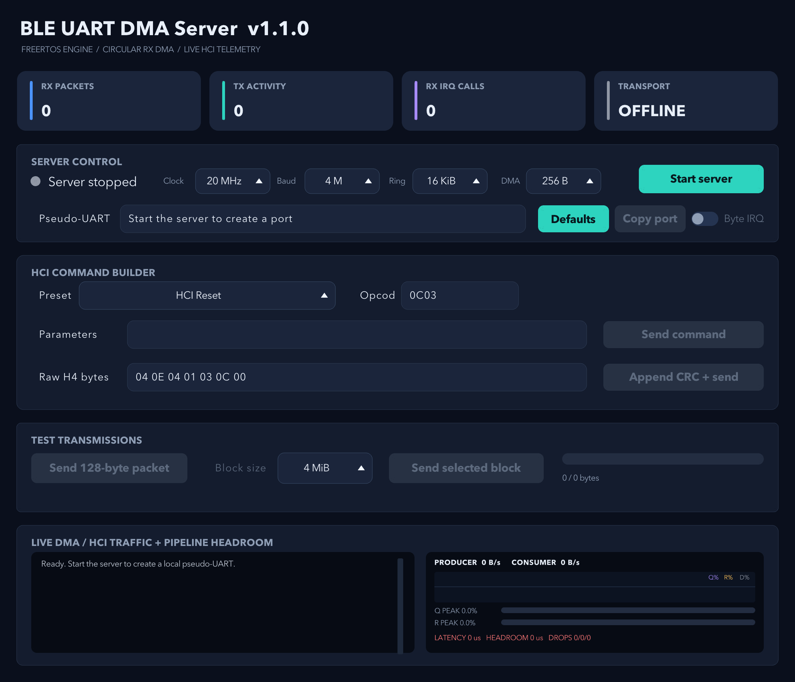
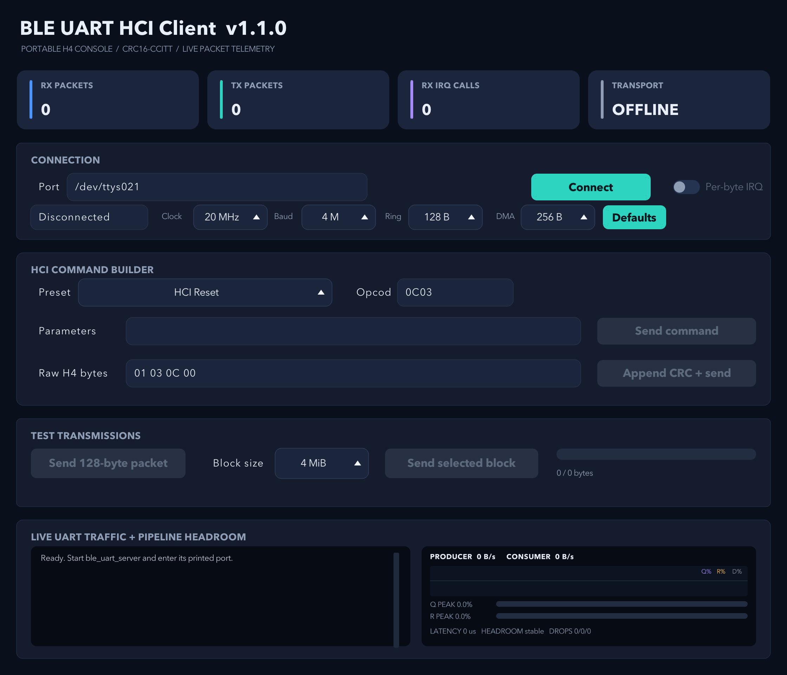

# UART DMA / BLE HCI demonstration suite

This repository is a complete desktop simulation and reference implementation
of a BLE HCI H4 link carried over UART. It combines real FreeRTOS queues, tasks,
notifications, semaphores, circular DMA receive logic, a TX DMA engine,
CRC16-CCITT framing, typed HCI wire structures, portable C clients, a Python
client, and matching graphical dashboards.

The normal local topology is:

```text
C client UI or Python client UI
            |
            | serial H4 packets + big-endian CRC16-CCITT
            v
    pseudo-UART slave device
            |
            v
continuous C server engine
            |
            v
FreeRTOS RX DMA -> producer queue -> HCI consumer
FreeRTOS TX queue -> CRC framing -> TX DMA -> client
```

The server creates the pseudo-UART, so start the server before connecting a
client. The graphical apps intentionally allow only one user-started transfer
direction at a time. When one side is sending a test transfer, every send button
on both dashboards remains disabled until the transfer ends. Protocol-generated
responses and acknowledgements continue to work.

A printable version of this guide is available as
[`output/pdf/UART_DMA_BLE_HCI_User_Guide.pdf`](output/pdf/UART_DMA_BLE_HCI_User_Guide.pdf).

## Contents

1. [Repository layout](#repository-layout)
2. [Prerequisites](#prerequisites)
3. [First-time setup](#first-time-setup)
4. [Configure and build with CMake](#configure-and-build-with-cmake)
5. [Run the graphical server and a client](#run-the-graphical-server-and-a-client)
6. [Use the dashboards](#use-the-dashboards)
7. [Run the command-line applications](#run-the-command-line-applications)
8. [Understand timing, buffers, IRQs, and telemetry](#understand-timing-buffers-irqs-and-telemetry)
9. [Saved settings and Defaults](#saved-settings-and-defaults)
10. [Run tests, benchmarks, and documentation](#run-tests-benchmarks-and-documentation)
11. [Troubleshooting](#troubleshooting)
12. [Wire protocol and implementation notes](#wire-protocol-and-implementation-notes)
13. [Port the engine to target hardware](#port-the-engine-to-target-hardware)
14. [License](#license)

## Repository layout

```text
include/uart_dma/       Public embedded-library headers
src/                    FreeRTOS UART/DMA, ring, CRC, and HCI implementation
apps/common/            Shared C protocol, serial, timing, settings, and UI code
apps/server/            Pseudo-UART and server serial-ingress components
apps/ble_uart_*.c       C command-line and graphical application entry points
python/dashboard_*.py   Python mirrors of the native dashboard components
python/ble_protocol.py  Python H4 framing, CRC, parser, and test protocol
python/serial_ports.py  Cross-platform Python serial-port discovery
python/ble_uart_app.py  Python graphical client controller and layout
demo/                   Embedded round-trip demo and macOS wrapper app
tests/                  Native unit and integration tests
tools/                  Bidirectional benchmark and buffer-effect validation
docs/                   Doxygen configuration and architecture guide
output/pdf/             Generated printable user guide
VERSION                 Shared application version displayed by every UI
```

The public [`uart_dma/uart_dma.h`](include/uart_dma/uart_dma.h) header is the
convenience umbrella for the complete embedded stack. A smaller integration may
include only the required component headers:

- `uart_crc16.h` for CRC16-CCITT.
- `uart_dma_ring_buffer.h` for the circular DMA receive buffer.
- `ble_hci_parser.h` for incremental H4 parsing.
- `ble_hci_wire.h` for packed, typed wire structures and endian helpers.
- `uart_dma_messages.h` for queue message types.
- `uart_dma_platform.h` for platform register and DMA hooks.

See the [runtime dataflow graph](docs/architecture.md#runtime-dataflow) and the
[repository component graph](docs/architecture.md#repository-component-graph)
for the relationships between the apps, libraries, FreeRTOS tasks, tests, and
documentation targets.

## Prerequisites

### Required for the native C build

- CMake 3.16 or newer.
- A C11 compiler and platform build tool. Apple Clang plus Ninja or Make works
  on macOS; GCC or Clang plus Ninja or Make works on Linux; MSVC or MinGW can
  build the portable client components on Windows.
- Git and network access during the first CMake configure. CMake fetches the
  pinned FreeRTOS kernel, raylib, raygui, and Space Grotesk sources.
- Doxygen when `UART_DMA_BUILD_DOCS=ON`, which is the default.

### Required for the Python client

- Python 3 with Tk support.
- `venv` support.
- pyserial 3.5 or newer and below version 4, installed from
  `python/requirements.txt`.

### Platform notes

- The continuous pseudo-UART server and graphical server supervisor build on
  macOS and Linux because they use POSIX pseudo-terminals.
- The portable C graphical client builds on macOS, Linux, and Windows.
- The Python Tk client runs on macOS, Linux, and Windows and can connect either
  to the local pseudo-UART or to a physical serial adapter.
- A physical UART is not required for local testing. The server prints a local
  pseudo-UART slave path for the clients.

Typical macOS prerequisites can be installed with:

```sh
brew install cmake ninja doxygen python
```

On Linux, install the equivalent C compiler, CMake, build tool, Doxygen,
Python, Tk, and venv packages using the distribution package manager. The exact
package names vary by distribution.

## First-time setup

Run all commands in this guide from the repository root.

### 1. Create the project-local Python environment

The repository intentionally uses `.venv` and excludes it from version control:

```sh
python3 -m venv .venv
```

Activate it in a POSIX shell:

```sh
source .venv/bin/activate
```

Or use its interpreter directly without activation:

```sh
.venv/bin/python -m pip install --upgrade pip
.venv/bin/python -m pip install -r python/requirements.txt
```

On Windows PowerShell, activation is typically:

```powershell
.venv\Scripts\Activate.ps1
python -m pip install --upgrade pip
python -m pip install -r python\requirements.txt
```

### 2. Choose a build directory

The examples use `build`. Any out-of-source directory is valid. Existing IDE
users may continue using `cmake-build-debug` or another configured directory.

```sh
cmake -S . -B build
```

The first configure can take longer because the pinned dependencies are
downloaded. Later builds reuse them from the build directory.

## Configure and build with CMake

There is no project Makefile. Always configure and build through CMake.

### Standard debug/development build

```sh
cmake -S . -B build -DCMAKE_BUILD_TYPE=Debug
cmake --build build --parallel
```

For a release build:

```sh
cmake -S . -B build-release -DCMAKE_BUILD_TYPE=Release
cmake --build build-release --parallel
```

Multi-configuration generators such as Visual Studio may require
`--config Debug` or `--config Release` during the build.

### CMake options

All options default to `ON` unless the platform cannot support the target.

| Option | Purpose |
| --- | --- |
| `UART_DMA_BUILD_DEMO` | Build the native FreeRTOS UART/DMA round-trip demo. |
| `UART_DMA_BUILD_SERVER` | Build the continuous POSIX pseudo-UART server. |
| `UART_DMA_BUILD_CLIENT` | Build the pure-C command-line UART client. |
| `UART_DMA_BUILD_PORTABLE_UI` | Build the raylib/raygui graphical dashboards. |
| `UART_DMA_BUILD_APP` | Build the macOS wrapper for the native demo. |
| `UART_DMA_BUILD_DOCS` | Build Doxygen HTML documentation and fail on warnings. |
| `BUILD_TESTING` | Build and register the CTest suites. |

For example, a small library-only build without the graphical apps or docs is:

```sh
cmake -S . -B build-library \
  -DUART_DMA_BUILD_DEMO=OFF \
  -DUART_DMA_BUILD_SERVER=OFF \
  -DUART_DMA_BUILD_CLIENT=OFF \
  -DUART_DMA_BUILD_PORTABLE_UI=OFF \
  -DUART_DMA_BUILD_APP=OFF \
  -DUART_DMA_BUILD_DOCS=OFF
cmake --build build-library --parallel
```

### Important build outputs

On macOS, the normal build produces:

```text
build/ble_uart_server
build/ble_uart_client
build/BLE UART Server.app
build/BLE UART Client.app
build/UART DMA Demo.app
build/uart_dma_demo
build/uart_dma_tests
build/docs/html/index.html
```

On Linux, the graphical applications are normally executables named
`ble_uart_server_ui` and `ble_uart_client_ui`. On Windows, the portable client
is emitted as an `.exe`; the POSIX pseudo-UART server is not built.

## Run the graphical server and a client

### Recommended local workflow

1. Build the project.
2. Start the graphical server.
3. Click **Start server**.
4. Wait for the **Pseudo-UART** field to display a path such as
   `/dev/ttys012` or `/dev/pts/5`.
5. Click **Copy port**, or select and copy the path manually.
6. Start either the C graphical client or the Python graphical client.
7. Paste the path into the client's **Port** field.
8. Confirm **Clock = 20 MHz**, **Baud = 4 M**, **Ring = 16 KiB**, and
   **DMA = 256 B** for the standard baseline.
9. Click **Connect**.
10. Wait for the client status to report that the BLE UART server identity was
    verified. Do not send before verification completes.

### Start the graphical server

macOS:

```sh
open "build/BLE UART Server.app"
```

Linux:

```sh
./build/ble_uart_server_ui
```

The graphical server is a supervisor. Clicking **Start server** launches the
real `ble_uart_server` engine as a child process, connects nonblocking control
and log pipes, and displays the pseudo-UART created by that engine.

### Start the portable C graphical client

macOS:

```sh
open "build/BLE UART Client.app"
```

Linux:

```sh
./build/ble_uart_client_ui
```

Windows:

```powershell
.\build\ble_uart_client_ui.exe
```

Use a Windows device name such as `COM3` when connecting to physical hardware.

### Start the Python graphical client

POSIX shell:

```sh
.venv/bin/python python/ble_uart_app.py
```

Windows PowerShell:

```powershell
.venv\Scripts\python.exe python\ble_uart_app.py
```

If no Python window appears, run the command from a terminal so import, Tk, and
serial errors remain visible. See [Troubleshooting](#troubleshooting).

### Connection verification

The C and Python graphical clients do not trust an opened port immediately.
Each client:

1. Opens the selected UART without blocking its UI indefinitely.
2. Enters the **VERIFYING** transport state.
3. Sends a deterministic 128-byte `TEST` probe with a unique identifier.
4. Waits up to 2.5 seconds for a CRC-valid completion event containing the
   same identifier, a success status, and a size of 128 bytes.
5. Enables the send controls only after that exact acknowledgement arrives.

A wrong, silent, or incompatible port is closed automatically and leaves a
visible error in the status field. The Python client performs the operating
system open on a background thread so an invalid driver cannot freeze Tk.

## Use the dashboards

The C client, Python client, and C server use matching controls and telemetry.
The server's settings describe its local receive path. A client's settings
describe that client's local receive path. They are deliberately not
synchronized between processes.

### Visual dashboard tour

The native server dashboard controls the pseudo-UART and the FreeRTOS-backed
simulation engine. The screenshot below shows the server before it has been
started. Controls that require a live peer are dimmed intentionally.



**Figure 1.** Native C server dashboard at startup. Click the image in a
Markdown viewer to inspect the full-resolution controls.

Read the server from top to bottom:

| Area | What it shows or controls |
| --- | --- |
| Statistic cards | Complete RX packets, TX activity, cumulative local RX IRQ calls, and current transport state. Each card is clickable and resets only its own displayed counter. |
| Server control | Starts or stops the engine; selects clock, baud, ring, DMA transaction size, and byte-IRQ mode; displays and copies the generated pseudo-UART path. |
| HCI command builder | Sends a typed preset or custom opcode/parameters from server to client, or appends CRC16-CCITT to a complete raw H4 packet. |
| Test transmissions | Sends a deterministic 128-byte diagnostic packet or the selected 16 KiB through 16 MiB block. The bar reports logical bytes completed. |
| Live traffic | Retains color-coded protocol, progress, completion, warning, and error messages in a scrollable log. |
| Pipeline headroom | Plots producer and consumer rates plus queue, ring, and DMA utilization. The horizontal meters report recent queue and ring peaks; the footer reports latency, headroom, and drops. |

The native C client is shown below. The Python client intentionally mirrors
this organization, control order, labels, defaults, colors, field alignment,
and behavior, so the same instructions apply to both clients.



**Figure 2.** Native C client dashboard at startup. The Python client presents
the same workflow with platform-native high-resolution text rendering.

The client replaces **Server control** with **Connection**. Enter or select a
port, choose the local receive simulation settings, and click **Connect**. The
client does not enable its send controls merely because the operating system
opened the device: it first sends the 128-byte identity probe described below
and changes **TRANSPORT** from **VERIFYING** to the active receive mode only
after the exact acknowledgement arrives.

The values shown in a screenshot can reflect saved settings from the previous
run. Click **Defaults** before following a baseline example; this selects a
20 MHz clock, 4 Mbaud, 16 KiB ring, 256-byte DMA transaction, 2 MiB block, and
DMA plus IDLE receive mode, with randomized thread load disabled.

### Example 1: connect and verify the correct UART

1. In the server, click **Start server**.
2. Wait for **Pseudo-UART** to contain a device path and **TRANSPORT** to become
   active.
3. Click **Copy port**.
4. Paste the path into either client's **Port** field.
5. Click **Defaults** on both apps, then click **Connect** on the client.
6. Watch the client enter **VERIFYING** while it sends its diagnostic probe.
7. Confirm that the client log reports a verified BLE UART server and that its
   send buttons become bright and enabled.

If a different UART is selected, the expected acknowledgement will not arrive.
The client closes that device and leaves a visible verification error instead
of silently treating an unrelated serial port as the server.

### Example 2: send an HCI Reset preset

1. Connect and complete verification.
2. Select **HCI Reset** in **Preset**. The builder fills opcode `0C03` and an
   empty parameter field.
3. Click **Send command**.
4. Observe **TX PACKETS** increase on the sender and **RX PACKETS** increase on
   the receiver.
5. Check the logs for the transmitted Command packet and the returned Command
   Complete Event. Both frames must report a valid CRC.

For a custom command, type a four-digit hexadecimal opcode and hexadecimal byte
pairs in **Parameters**. For a complete packet, type the H4 indicator, typed HCI
header, and payload in **Raw H4 bytes**, then click **Append CRC + send**.

### Example 3: compare a 128-byte packet with a 2 MiB transfer

1. Click **Send 128-byte packet** and observe the complete packet in the log.
   The transfer is small enough that displaying its bytes does not affect
   throughput measurements.
2. Set **Block size** to **2 MiB** and click **Send selected block**.
3. Watch the progress bar move smoothly while the sender's other send controls
   and the receiver's send controls remain disabled by half-duplex lockout.
4. Watch producer and consumer rates in the pipeline panel. Queue, ring, and DMA
   traces are percentages of their independently configured capacities.
5. At completion, confirm the log reports the full logical byte total, pattern
   verification, CRC status, elapsed time, and receive IRQ calls for that one
   complete transmission.

At 4 Mbaud, the 2 MiB logical transfer should be near 4.2 seconds in either
direction, plus framing and host scheduling overhead. Large packet bodies are
not printed, because converting and displaying megabytes of hexadecimal text
would become the bottleneck being measured.

### Example 4: compare DMA and per-byte IRQ accounting

1. Leave **Per-byte IRQ** off, set **DMA** to **256 B**, and send the 128-byte
   diagnostic. The receiver normally needs one DMA completion for that wire
   frame.
2. Record the receiver's **RX IRQ CALLS** card and the per-transmission IRQ value
   in its completion log.
3. Click the **RX IRQ CALLS** card to reset that local cumulative display.
4. Enable **Per-byte IRQ** on the receiver and repeat the same transmission.
5. The completion log should now report one receive IRQ per wire byte. The count
   is therefore slightly larger than 128 because H4, ACL/test metadata, and CRC
   bytes are also carried on the wire.

The toggle is local to each application. Change it on the side whose receive
implementation you want to study; it is not mirrored to the peer.

### Example 5: expose ring pressure and recovery

1. Click **Defaults**, then reduce the receiver's **Ring** selection to
   **256 B** while leaving its DMA transaction at **256 B**.
2. Send a test packet whose complete IDLE-delimited wire frame approaches or
   exceeds the selected ring capacity.
3. Observe **R%** and **R PEAK** approach 100 percent. A genuine overwrite
   increments the ring-drop total and causes packet validation to fail.
4. Restore **Ring** to **16 KiB** and repeat. The frame should validate, ring
   utilization should fall substantially, and the quiet sample after transfer
   completion should return the live utilization to zero.

This experiment demonstrates capacity, not an artificial throughput throttle:
the ring must retain a complete IDLE-delimited span, while the DMA selection
controls how many bytes are grouped into each simulated DMA completion IRQ.

### Top statistic cards

- **RX PACKETS** counts complete packets received by this application.
- **TX PACKETS** or **TX ACTIVITY** counts packets or events sent by this
  application.
- **RX IRQ CALLS** is the cumulative local receive interrupt count.
- **TRANSPORT** reports `OFFLINE`, `VERIFYING`, `DMA + IDLE`, or `BYTE IRQ`.

The statistic cards are buttons. Click a numeric card to reset that displayed
counter to zero. Resetting one app's card does not reset any other app.

### Connection and server controls

Client controls:

- **Port** selects or edits the serial device.
- **Baud** selects the requested UART line rate.
- **Connect/Disconnect** opens or closes the selected port.
- **Clock**, **Ring**, and **DMA** configure the local receive simulation.
- **Per-byte IRQ** selects byte-interrupt receive accounting instead of the
  default DMA/IDLE accounting.
- **Busy min**, **Busy max**, and **R%** are the three inline competing-thread
  controls. A zero maximum disables the workload. Client changes are sent to
  the verified server as a typed HCI vendor command.
- **Defaults** restores and saves the baseline settings listed below.

Server controls:

- **Start server/Stop server** manages the continuous FreeRTOS engine.
- **Pseudo-UART** displays the client-facing device path.
- **Copy port** copies that path to the native clipboard.
- The remaining timing, buffer, IRQ, and Defaults controls have the same local
  meaning as on the clients.

Text fields support native clipboard shortcuts: Cmd+C, Cmd+X, and Cmd+V on
macOS; Ctrl+C, Ctrl+X, and Ctrl+V on Windows and Linux.
If any of the three numeric busy-work fields is left empty, it becomes `0` when
focus leaves the field. Older saved load formats are migrated to the disabled
`0 / 0 / 0%` state instead of accidentally enabling background work.
Within the busy-work group, Tab and Shift+Tab move forward and backward through
the three fields. Drag upward or downward inside a field to increase or decrease
it; min/max move in 1,000-cycle steps and R% moves in one-percent steps. Raising
the minimum above the current maximum raises the maximum to match. You can still
set maximum to `0` explicitly to disable the workload.

### HCI command builder

The **Preset** menu provides:

- HCI Reset.
- Read Local Version.
- Read BD_ADDR.
- LE Read Buffer Size.
- LE Enable Scan.
- LE Disable Scan.

Selecting a preset fills the opcode and parameter fields. You can then edit the
four-digit hexadecimal opcode or the hexadecimal parameter bytes before
clicking **Send command**.

Parameter input accepts hexadecimal byte pairs separated by spaces, commas,
colons, or tabs. For example:

```text
01 00
```

The **Raw H4 bytes** field accepts a complete H4 packet beginning with its H4
packet indicator. Do not append a CRC manually. **Append CRC + send** calculates
and appends the two-byte big-endian CRC trailer.

### Test transmissions

- **Send 128-byte packet** sends a small deterministic diagnostic packet. Its
  bytes may be shown in the log because it is intentionally small.
- **Block size** selects 16 KiB, 64 KiB, 128 KiB, 512 KiB, 1 MiB, 2 MiB,
  4 MiB, 8 MiB, or 16 MiB.
- **Send selected block** sends the selected deterministic multi-packet ACL
  transfer.
- The progress bar updates approximately 30 to 60 times per second without
  adding every animation update to the retained log.

Large transfers are split into typed H4 ACL packets with deterministic payload
bytes and individual CRC trailers. The receiver validates the transfer ID,
declared total, offsets, chunk sizes, payload pattern, packet CRCs, and final
size. The log records only start, periodic progress, completion, and error
messages so formatting cannot become the throughput bottleneck.

At a requested 4 Mbaud, a 2 MiB logical payload should take approximately
4.2 seconds in either direction. The exact wire byte count is larger because
each chunk carries H4, ACL, test metadata, and CRC bytes.

### Half-duplex send lockout

User-started transmissions are intentionally half-duplex:

1. The originating app disables **Send command**, **Append CRC + send**,
   **Send 128-byte packet**, and **Send selected block** when a test starts.
2. The receiving app recognizes the transfer START frame and disables the same
   four buttons.
3. Both apps keep receiving, parsing, updating telemetry, and exchanging
   protocol-generated acknowledgements.
4. The receiving END frame re-enables the receiver's buttons.
5. Completion of the sender's transfer worker re-enables the sender's buttons.

If a send button is dimmed during traffic, wait for the active transfer to
complete. Do not interpret the disabled state as a lost connection.

### Logs

Every graphical log:

- Retains the most recent 256 lines.
- Uses colors to distinguish TX, RX, warnings, errors, and test activity.
- Supports mouse-wheel scrolling and a scrollbar.
- Preserves manual scroll position instead of forcing the view back to the
  newest line.
- Avoids hexadecimal dumps for large test chunks.

## Run the command-line applications

### Continuous server engine

Start the engine directly when a graphical server supervisor is not needed:

```sh
./build/ble_uart_server
```

It prints a pseudo-UART path such as `/dev/ttys012`. Keep the process running
and connect a client to that path. Stop it with Ctrl+C.

The server reads the following newline-terminated commands from standard input:

| Command | Effect |
| --- | --- |
| `irq` | Select per-byte RXNE interrupt receive mode. |
| `dma` | Select circular DMA plus UART IDLE receive mode. |
| `mode` | Send the current receive mode to the client. |
| `stats` | Print cumulative RX IRQ and pipeline statistics. |
| `buffers` | Print active ring and DMA sizes. |
| `timing` | Print clock, requested baud, OSR, SBR, actual baud, and error. |
| `clock HZ` | Change the simulated LPUART source clock. |
| `baud RATE` | Change the requested line rate. |
| `ring BYTES` | Change circular ring capacity from 32 through 65536 bytes. |
| `dma-buffer BYTES` | Change DMA transaction size from 32 through 4096 bytes. |
| `tx HEX_BYTES` | Queue one H4 packet represented as hexadecimal bytes. |
| `test BYTES` | Start a deterministic server-to-client test transfer. |
| `load status` | Print the current randomized task configuration and measured activity. |
| `load MIN MAX PERCENT` | Set the minimum and maximum busy cycles and the random-range weight. A zero maximum disables the task. |

Do not resize the ring or DMA transaction while an inbound test transfer is
active. The engine rejects that reconfiguration because buffer geometry must
remain stable for a complete transmission.

### Pure-C terminal client

Start the server, then connect using its printed port:

```sh
./build/ble_uart_client /dev/ttys012 4000000
```

If baud is omitted, the client defaults to 4000000. The interactive commands
are:

| Command | Effect |
| --- | --- |
| `reset` | Send HCI Reset. |
| `version` | Send Read Local Version. |
| `address` | Send Read BD_ADDR. |
| `buffers` | Send LE Read Buffer Size. |
| `scan-on` | Enable LE scanning. |
| `scan-off` | Disable LE scanning. |
| `send OPCODE [PARAM ...]` | Send a custom hexadecimal HCI command. |
| `raw BYTE [BYTE ...]` | Send raw H4 bytes with an automatically appended CRC. |
| `mode dma` | Request DMA/IDLE server receive mode. |
| `mode irq` | Request per-byte server receive mode. |
| `mode query` | Query the authoritative server receive mode. |
| `help` | Print the command list. |
| `quit` | Close the port and exit. |

For a one-shot smoke test, append a preset name:

```sh
./build/ble_uart_client /dev/ttys012 4000000 reset
```

The one-shot client sends the preset, waits up to two seconds for a parsed
response, prints its CRC result, and exits with a nonzero status on failure.

## Understand timing, buffers, IRQs, and telemetry

### Selectable values and defaults

| Control | Selectable values | Default |
| --- | --- | --- |
| Clock | 4, 8, 12, 16, 20, 24, 32, 40, 48 MHz | 20 MHz |
| Baud | 115200, 1 M, 2 M, 3 M, 4 M | 4 M |
| Ring | 32 B, 64 B, 128 B, 256 B, 1 KiB, 4 KiB, 16 KiB, 64 KiB | 16 KiB |
| DMA | 32 B, 64 B, 128 B, 256 B, 512 B, 1 KiB, 4 KiB | 256 B |
| Block | 16 KiB, 64 KiB, 128 KiB, 512 KiB, 1, 2, 4, 8, 16 MiB | 2 MiB |
| IRQ mode | DMA + IDLE or Per-byte IRQ | DMA + IDLE |
| Random load | Minimum busy cycles, maximum busy cycles, random weight 0–100% | 0, 0, 0% (disabled) |

### Randomized full-system thread load

The three values are displayed directly in each app's main control panel. There
is no enable switch, modal, seed, or period setting. **Maximum busy = 0**
disables the workload. Otherwise a deterministic generator selects a value from
the minimum-to-maximum span and **R%** controls how much of that random span is
applied:

```text
random offset = random(0, maximum - minimum) * R% / 100
busy cycles   = minimum + random offset
busy time     = busy cycles / selected system clock
```

The task runs at `tskIDLE_PRIORITY + 2`: above the application consumer and
ordinary server helper tasks, but below the UART producer and TX tasks. This
models unrelated work in a complete embedded system that delays packet
consumption without unrealistically blocking the critical receive producer.
Queue pressure, measured latency, headroom, and genuine queue/ring drops are
therefore allowed to emerge from scheduling.

At `0%`, every burst stays at the minimum. At `100%`, the complete minimum-to-
maximum range is available. Intermediate percentages progressively widen the
random range toward the maximum; they are not an activation probability or CPU
duty-cycle target. Equal nonzero minimum and maximum values create fixed-length
busy bursts. The selected system clock converts cycles to elapsed time.

For example, `load 50000 250000 35` uses a minimum of 50,000 cycles and allows
35 percent of the 200,000-cycle random span. `load 0 0 0` disables the task.
`load status` reports the configured values, burst count, total cycles, measured
busy microseconds, most recent burst, and current busy state.

### KW47 LPUART model

The server and clients model an NXP KW47-style LPUART baud generator. The
divisor search evaluates effective oversampling ratios from 4 through 32 and
SBR values from 1 through 8191, selecting the pair with the smallest baud
error:

```text
actual baud = source clock / (OSR * SBR)
```

At a 20 MHz source clock and requested 4 Mbaud, OSR=5 and SBR=1 produce exactly
4 Mbaud. A theoretical 5 Mbaud combination exists at OSR=4 and SBR=1, but the
application intentionally exposes only established rates through 4 Mbaud.

The simulation does not reject a packet from a theoretical clock-rate check.
It samples the entire 8-N-1 waveform using the selected divisors and continuous
phase. Sampled bytes, including corrupted bytes, continue through DMA, H4
framing, and CRC validation. A warning appears only when the actual simulated
packet has changed bits or a framing error. Large transfers aggregate these
failures into a compact completion warning.

### Ring capacity

The circular ring holds bytes delivered before the UART IDLE boundary. The
server's producer wakes at IDLE and treats that span as one logical framed
packet. Therefore:

- The ring must be large enough for the complete wire frame.
- A ring smaller than the wire frame produces a real simulated overwrite and a
  ring drop.
- Ring size is not a per-render-frame or per-read throughput budget.
- Decreasing ring size can increase the displayed utilization percentage even
  when byte rate is unchanged.

### DMA transaction size

DMA size controls the maximum bytes completed by one simulated DMA transaction.
It does not directly throttle the requested baud. In DMA mode, expected receive
interrupts for one wire frame are approximately:

```text
DMA IRQ calls = ceil(wire frame bytes / selected DMA bytes)
```

For example, a 255-byte wire frame with a 256-byte DMA size needs one DMA
completion. The same frame with a 64-byte DMA size needs four completions.

### Per-byte IRQ mode

When **Per-byte IRQ** is enabled, every received wire byte invokes the simulated
RXNE handler. Consequently, the per-transmission IRQ count should equal the
number of transmitted wire bytes. This mode is intentionally much more
interrupt-heavy than DMA + IDLE.

### IRQ counters

IRQ values are application-local and are never synchronized over HCI:

- The dashboard card is cumulative for that app until clicked or the process
  exits.
- An ordinary packet log contains the IRQ calls for that packet.
- A chunked test transfer resets its transmission count at START, accumulates
  across every chunk, and logs one final count at END.
- During client-to-server tests, the server publishes in-flight cumulative and
  transfer IRQ totals at 256 KiB progress boundaries.

### Pipeline graph

The lower dashboard monitor distinguishes current rates from buffer pressure:

- Blue is measured producer throughput.
- Cyan is measured consumer throughput.
- Purple **Q%** is peak completed-packet queue utilization.
- Amber **R%** is peak circular-ring utilization.
- Gray **D%** is peak DMA transaction utilization.
- **Q PEAK** shows packet queue occupancy as a percentage of 16 slots.
- **R PEAK** shows ring occupancy as a percentage of selected ring capacity.
- **LATENCY** is measured enqueue-to-consume time.
- **HEADROOM** is measured time to buffer exhaustion when producer throughput
  exceeds consumer throughput; otherwise it reads `stable`.
- **DROPS** lists CRC, queue, and ring drops.

All buffer series use percentages of their own configured capacity and clamp at
100 percent. Short ring and DMA peaks remain visible for one half-second sample
and clear on the following quiet sample. History retains 120 half-second
samples, or approximately one minute.

The server polls detailed pipeline state at 10 Hz and aggregates graph points
at 2 Hz. The Python monitor repaints at 20 Hz while using the same half-second
sampling units. A wider gray DMA trace is drawn beneath an amber ring trace so
equal percentages remain separately visible.

## Saved settings and Defaults

The C and Python clients share one client profile. The graphical server uses an
independent server profile. Each profile saves:

- Clock.
- Baud.
- Ring capacity.
- DMA transaction size.
- Large-transfer block size.
- Per-byte IRQ mode.
- Randomized thread-load minimum, maximum, and percentage weight.

The clients also share the last selected port. Typed, dropdown-selected, and
attempted client port names are saved.

Preference locations are:

| Platform | Directory |
| --- | --- |
| macOS | `~/Library/Application Support/BLE UART/` |
| Windows | `%APPDATA%\BLE UART\` |
| Linux | `${XDG_CONFIG_HOME:-~/.config}/ble-uart/` |

Files in that directory are:

- `client-port.txt` for the shared last client port.
- `client-settings.txt` for both graphical clients.
- `server-settings.txt` for the graphical server.

Clicking **Defaults** immediately applies and saves:

```text
Clock:       20 MHz
Baud:        4 Mbaud
Ring:        16 KiB
DMA:         256 B
Block:       2 MiB
Receive:     DMA + IDLE
Thread load: Disabled (minimum 0, maximum 0, R% 0)
```

Defaults also resets stale pipeline telemetry so historical percentages from
the prior geometry do not remain on the graph.

## Run tests, benchmarks, and documentation

### Complete native and Python test suite

```sh
ctest --test-dir build --output-on-failure
```

The registered tests cover the native UART/DMA implementation, round-trip demo,
LPUART model, Python framing and preferences, bidirectional timing parity, and
buffer-size effects.

### Python unit tests only

```sh
.venv/bin/python -m unittest discover -s python/tests -p 'test_*.py'
```

### Bidirectional benchmark

The benchmark launches the real continuous server, sends the same transfer in
both directions sequentially, validates CRCs and packetization, and rejects an
excessive timing ratio:

```sh
.venv/bin/python tools/benchmark_bidirectional.py \
  build/ble_uart_server \
  --size 2097152 \
  --baud 4000000 \
  --mode dma \
  --ring 16384 \
  --dma 256 \
  --max-ratio 1.20
```

A healthy 4 Mbaud baseline should report roughly 4.2 seconds per 2 MiB
direction and a ratio close to 1.0.

### Buffer-effect validation

```sh
.venv/bin/python tools/test_buffer_effects.py build/ble_uart_server
```

This verifies that selected ring and DMA sizes change overflow behavior and IRQ
counts as the simulated hardware model specifies.

### Doxygen API documentation

Doxygen is part of the default build:

```sh
cmake --build build --target docs
```

Open the generated index on macOS:

```sh
open build/docs/html/index.html
```

On Linux, open `build/docs/html/index.html` in a browser. Documentation warnings
are errors. A distribution or cross-compilation build may disable docs with:

```sh
cmake -S . -B build -DUART_DMA_BUILD_DOCS=OFF
```

## Troubleshooting

### CMake cannot download a dependency

The first configure needs network access to the pinned upstream repositories.
Confirm Git can reach GitHub, then retry the same configure command. Do not
delete a working build directory merely to change an application setting.

After dependencies have been populated, an intentionally offline reconfigure
can use the existing sources:

```sh
cmake -S . -B build -DFETCHCONTENT_FULLY_DISCONNECTED=ON
```

Use that only when the build directory already contains all fetched sources.

### Doxygen is missing

Install Doxygen or configure with `-DUART_DMA_BUILD_DOCS=OFF`. The default build
will stop if Doxygen is unavailable because documentation is a normal target.

### The Python app displays no window

Run it from a terminal:

```sh
.venv/bin/python python/ble_uart_app.py
```

Confirm that:

1. `.venv` exists.
2. `python/requirements.txt` was installed into that environment.
3. `python -c "import tkinter"` succeeds.
4. The current desktop session permits graphical windows.

On Linux, a missing `tkinter` import usually means the distribution's Python Tk
package is not installed.

### Connecting to an invalid UART appears unsuccessful

That is expected. The clients open asynchronously or nonblocking, send the
128-byte identity probe, and require the exact response. A wrong UART is closed
after the open error or 2.5-second verification timeout. Select the path printed
by the currently running server.

### The pseudo-UART path changed

A new server process can receive a different pseudo-terminal number. Copy the
new path after every server restart. The remembered client path is a convenience
and can legitimately point to an old device.

### Send buttons are disabled

Check the transport and transfer state:

- `VERIFYING` means the connection probe has not completed.
- `OFFLINE` means no verified connection exists.
- A moving progress bar or incoming TEST log means half-duplex lockout is
  active. Wait for the transfer END/completion message.
- If a process was interrupted mid-transfer, disconnect and reconnect to clear
  its local transfer state.

### Server-to-client transfer is slower than expected

1. Confirm both dashboards show 4 Mbaud.
2. Confirm the server timing log shows the expected requested and actual rate.
3. Use Defaults on both apps for a 20 MHz clock, 16 KiB ring, and 256 B DMA.
4. Ensure large chunks are not being hex-dumped; current builds log only compact
   progress messages.
5. Run `tools/benchmark_bidirectional.py` to separate engine timing from UI or
   physical-driver behavior.
6. Remember that 16 MiB at 4 Mbaud takes about 33.6 seconds before framing
   overhead; only 2 MiB is expected near 4.2 seconds.

### Ring percentage reaches 100 percent or frames drop

The selected ring is smaller than, or equal to, the incoming IDLE-delimited
wire span. Increase the ring size. A 256-byte ring is intentionally easy to
saturate with a roughly 255-byte framed packet.

### IRQ count does not match expectation

- In byte mode, compare against wire bytes, not logical payload bytes.
- In DMA mode, use `ceil(wire bytes / DMA size)` for each packet.
- The dashboard card is cumulative; the log's completion value is per packet or
  per complete multi-chunk transmission.
- Counters belong to the receiving app only.

### CRC or UART simulation warnings appear

The chosen clock and requested baud produce sampling errors for the actual
simulated packet. Increase the source clock, reduce baud, or use Defaults. The
simulator still processes the corrupted bytes so the warning reflects a real
sampled failure rather than a theoretical threshold.

### The log is not following new messages

The log preserves manual scrolling. Scroll to the bottom to resume viewing the
newest entries. Old entries are discarded after 256 retained lines.

## Wire protocol and implementation notes

Every transmitted frame has this form:

```text
[H4 packet indicator + typed HCI header + HCI payload] [CRC high] [CRC low]
```

The CRC is CRC16-CCITT and is stored as a typed big-endian
`BleHciCrcTrailer_t`. HCI multibyte fields use explicit typed wire structures
and endian conversion helpers. Header lengths are derived from `sizeof` their
corresponding structures instead of duplicated numeric constants.

Supported H4 packet indicators include Command, ACL, SCO, Event, and ISO. The
incremental parser selects the typed header layout, reads its encapsulated
payload length, applies packet-specific masks such as ISO's 14-bit length, and
waits for the complete CRC-protected frame.

The deterministic large-transfer protocol uses ACL packets containing:

- A `TEST` signature and protocol version.
- START and END flags.
- A 16-bit transfer identifier.
- Declared total logical size.
- Chunk offset and chunk length.
- A reproducible payload pattern.

This metadata lets the receiver detect missing, duplicated, reordered, or
corrupted chunks without storing an entire 16 MiB transfer in memory.

The server uses the actual FreeRTOS kernel fetched by CMake. Its receive path is:

```text
pseudo-UART read
  -> LPUART sampler
  -> circular DMA writes and completion IRQs
  -> UART IDLE notification
  -> producer task
  -> CRC verification
  -> 16-slot packet queue
  -> consumer task
  -> HCI parser and application callback
```

Its response path is:

```text
typed HCI message
  -> TX queue
  -> TX engine task
  -> CRC trailer
  -> platform TX DMA hook
  -> pseudo-UART
```

Large server test transfers coalesce host writes while preserving individual H4
frames. The coalescing window spans two visual progress intervals so a 60 Hz
client remains continuously supplied without producing one host syscall per
packet. Pseudo-UART writes wait for actual descriptor writability rather than
adding a fixed delay for every partial write.

## Port the engine to target hardware

The desktop server supplies simulated register objects and implements
`UartDma_PlatformTransmitDma` by writing to a pseudo-terminal. A target port
should keep the protocol, queue, parser, and ring components while replacing
the platform boundary.

Recommended steps:

1. Include `uart_dma/uart_dma.h` or the smaller required public headers.
2. Provide real `USART_HW`, `DMA_RX_STREAM`, and `DMA_TX_STREAM` register
   mappings through the platform header.
3. Configure a circular RX DMA buffer using `UartDma_GetRxBuffer()` and the
   selected or fixed ring capacity.
4. Update the committed DMA write index on transfer events.
5. Call `DMA_RX_Complete_IRQHandler()` on each completed DMA transaction.
6. Call `USART_IRQHandler()` for UART IDLE and, when supported, RXNE byte mode.
7. Implement `UartDma_PlatformTransmitDma()` to start a real nonblocking TX DMA
   transfer.
8. Call `DMA_TX_Complete_IRQHandler()` only from the actual TX completion ISR so
   the TX semaphore is released at the correct time.
9. Provide `UartDma_PlatformTimeUs()` from a monotonic target timer when
   microsecond latency telemetry is desired.
10. Register HCI command and ACL handlers before starting the scheduler.
11. Keep ISR priorities compatible with FreeRTOS `FromISR` API requirements.
12. Validate cache clean/invalidate requirements on cache-enabled MCUs.
13. Test DMA wraparound, IDLE boundaries, queue-full behavior, CRC errors, and
    the smallest supported ring before connecting a BLE controller.

The desktop pseudo-UART is a development adapter, not an embedded requirement.
The reusable libraries do not depend on the graphical dashboards.

## License

This project is available under the [MIT License](LICENSE). You may use,
modify, merge, publish, distribute, sublicense, and sell copies under the
conditions stated in the license.

## Additional documentation

- [`apps/README.md`](apps/README.md) contains implementation-focused notes for
  the C clients and server.
- [`python/README.md`](python/README.md) describes the Python module boundaries.
- [`docs/architecture.md`](docs/architecture.md) contains the runtime and
  repository graphs.
- Generated Doxygen output documents every project-owned C, Objective-C, and
  Python module.
