# Architecture

This document provides two complementary views of the repository. The runtime
dataflow follows bytes through a complete client/server exchange. The component
graph shows source ownership, dependencies, build targets, tests, and generated
documentation.

Solid arrows represent runtime flow or direct code dependencies. Dashed arrows
represent CMake target and build dependencies.

## Runtime dataflow

[Open the runtime graph at full size](./diagrams/architecture-1.svg).

## Repository component graph

[Open the component graph at full size](./diagrams/architecture-2.svg).

The editable definitions are retained in
[architecture-mermaid.md](architecture-mermaid.md). Regenerate the SVG files
with Mermaid CLI after changing that source.
